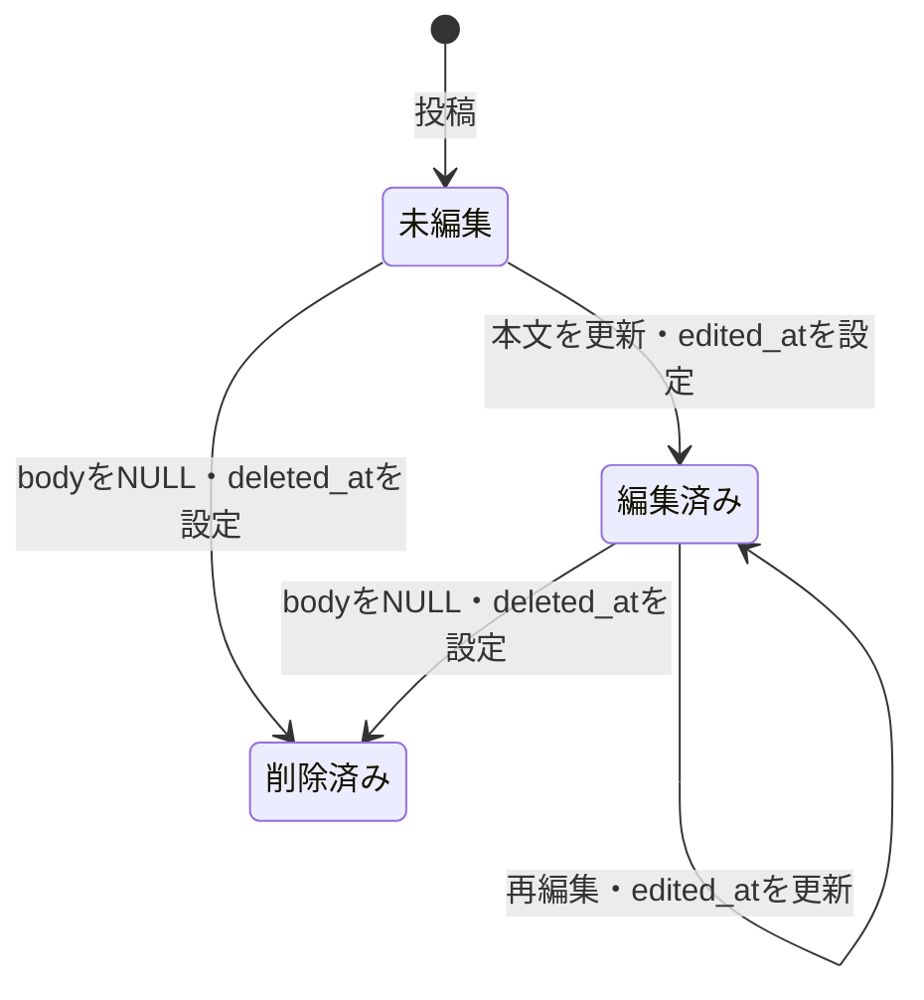
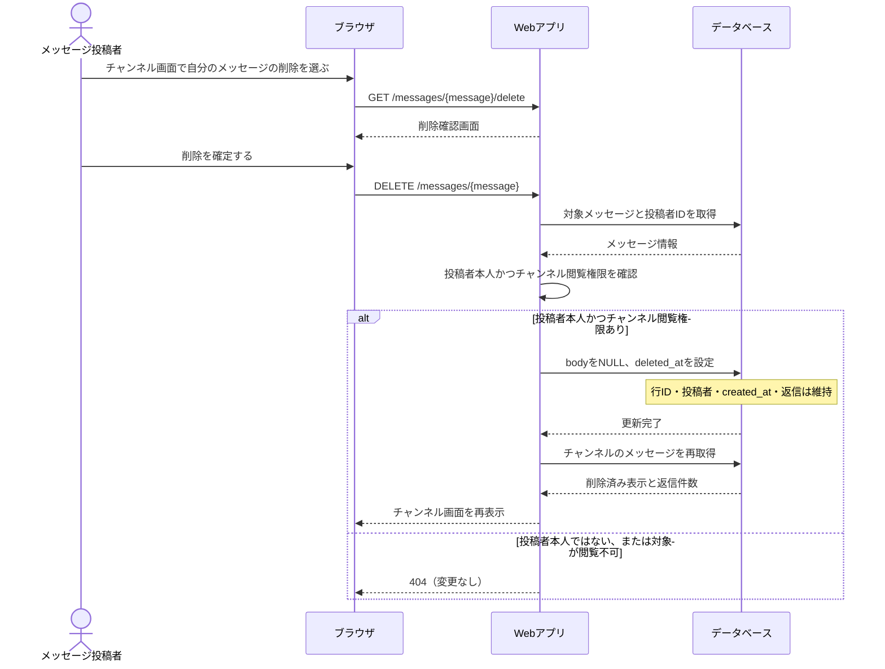

# 振る舞い設計

## メッセージの状態遷移

`未編集` は `edited_at` と `deleted_at` が未設定、`編集済み` は `edited_at` のみ設定、`削除済み` は `deleted_at` 設定済みで `body` が `NULL` の状態。削除済み行は残し、投稿者・投稿時刻・親子関係を保持する。画面には本文の代わりに「このメッセージは削除されました」と表示する。削除済みメッセージの編集状態は、削除前の `edited_at` 値として保持する。

## チャンネルメンバー管理

- メンバー管理画面を開くたびに、ChannelPolicy でプライベートチャンネルの作成者であることを確認してから現在のメンバーを表示する。
- 表示名またはメールアドレスの検索語を受け取った場合、部分一致する社員のうち未所属の社員だけを候補に表示する。追加操作では社員IDを再検証して `channel_user` に登録し、検索結果とメンバー一覧を再表示する。
- 削除操作では ChannelPolicy で対象が作成者以外の所属メンバーであることを確認してから `channel_user` の行を削除し、メンバー一覧を再表示する。

## シーケンス：投稿者がメッセージを削除

## 例外方針

- 入力値の空欄・上限超過・形式エラーは `screens.md` の項目別メッセージで画面に返す。サーバー側でも検証し、入力値とエラー項目を画面に戻す。
- 未認証の画面アクセスはログインへ誘導する。非メンバーのプライベートチャンネルと、存在しないチャンネルは同じ404として扱い、チャンネル名や内容を漏らさない。
- 作成者以外のチャンネル編集・削除、投稿者以外またはチャンネル閲覧不可の利用者によるメッセージ編集・削除は変更せず404とする。操作権限は各リクエストでポリシーにより確認する。
- 同じ公開範囲に同名チャンネルがある場合は作成・更新を行わず、チャンネル名欄にエラーを返す。
- メッセージの論理削除では `body = NULL`、`deleted_at` を設定し、メッセージ行と返信を保持する。検索・公開APIでは削除済み行を除外する。
- チャンネル削除ではチャンネル、メンバー情報、メッセージ・返信を外部キー連鎖で削除する。投稿者によるメッセージ削除は論理削除であり、返信を保持する。
- 公開APIの存在しない／非公開チャンネル応答は同一の404 JSON。その他の予期しないAPIエラーは詳細を含めない500 JSONを返す。Web画面の予期しないエラーも内部情報を表示しない。
- 削除済み親に付いた未削除返信は、公開APIで返信だけを返し、`parent_id` は削除済み親のIDのままにする（Q-19）。画面上のスレッドでは親の削除跡を表示し、既存返信を保持する。
- F-07 のメンバー管理画面・追加・削除は、各リクエストでプライベートチャンネルの作成者かをポリシーで確認する。作成者以外、公開チャンネル、作成者自身の削除対象指定は404とし、メンバー情報を表示・変更しない。
- メンバー検索は表示名またはメールアドレスの部分一致とし、追加済みの社員は検索候補から除く。追加対象の社員IDはサーバー側で存在確認し、重複追加時は日本語エラーを表示する。

## 実装方針

Laravelの標準的なMVC構成に沿う。
