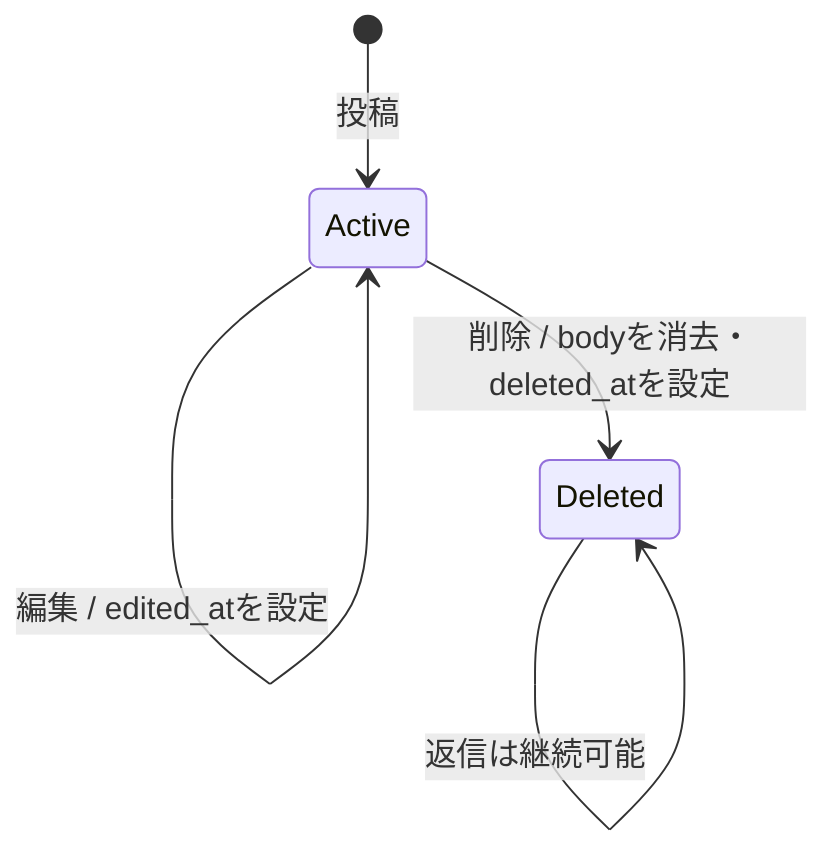
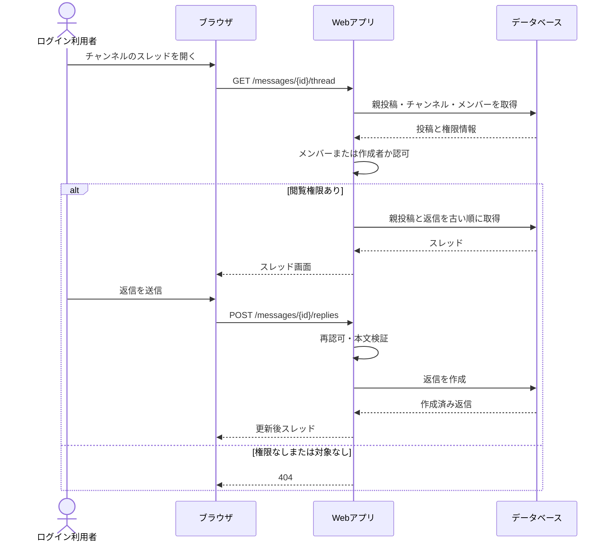

# 振る舞い設計

## メッセージ状態

削除済みメッセージは画面に跡を残し、編集はできない。返信件数と既存返信は維持する。APIでは削除済み投稿とその本文を返さない。

## 代表シーケンス：プライベートチャンネルの返信

## 例外方針

- 入力不正はフォームに戻し、入力値と項目別エラーを示す。全書き込みでサーバー側検証を行う。
- 未認証はログイン画面へ誘導する。権限のないチャンネルや投稿は404とし、非公開情報の存在を漏らさない。
- 同一公開範囲内のチャンネル名重複は保存せず、名前欄にエラーを示す。
- 投稿削除は本文を空にして削除日時を記録する。チャンネル削除は関連投稿・返信・メンバーをまとめて削除する。
- 削除確認の詳細（チャンネル名入力の要否）は Q-05 回答後に確定する。
- データベース障害など予期しない失敗は共通エラー画面とし、内部情報を画面に出さない。
