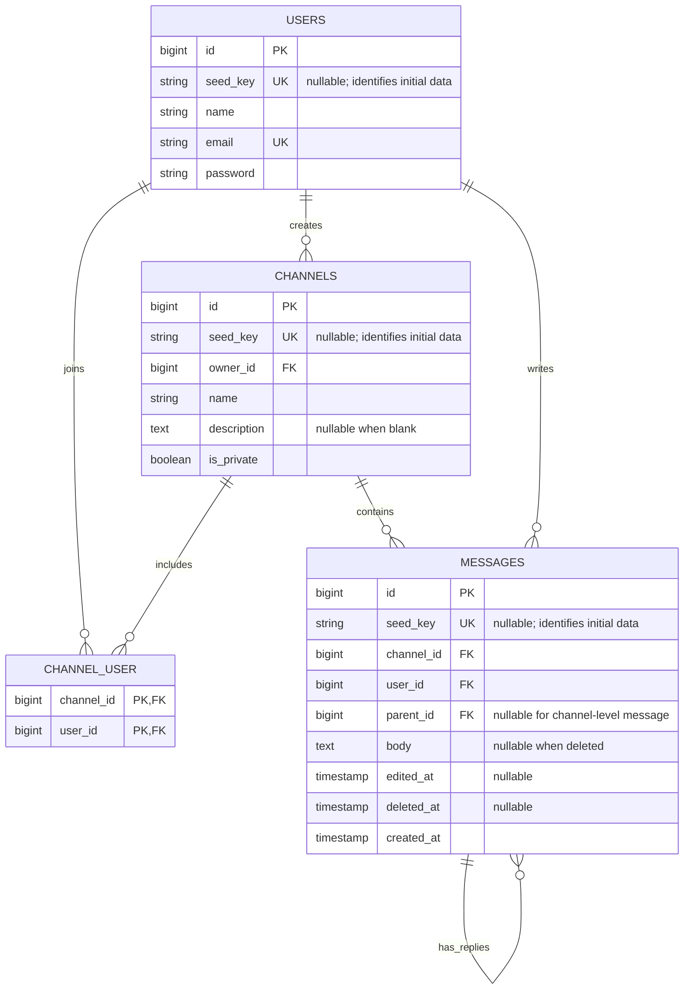

# データ設計

## ER図

`parent_id` が null の行はチャンネルへの投稿、値がある行は返信を表す。返信は1段までなので、返信行の `parent_id` はチャンネル投稿を指す。削除済み投稿も同じ行・IDを残し、返信の参照先を維持する。

## テーブル定義

| テーブル | カラム | 制約・意味 |
|:--|:--|:--|
| `users` | `id`, `seed_key`, `name`, `email`, `password` | `id` は主キー。`seed_key` は初期データ行を識別する nullable unique キーで、通常登録では `NULL`。`name` は表示名で30文字以内。`email` は一意で、254文字以内、形式を検証する（Q-18）。`password` は登録パスワードをハッシュ化して保存する。 |
| `channels` | `id`, `seed_key`, `owner_id`, `name`, `description`, `is_private` | `id` は主キー。`seed_key` は初期データ行を識別する nullable unique キーで、通常作成では `NULL`。`owner_id` は `users.id` への外部キー。`name` は50文字以内、`description` は200文字以内、`is_private` が公開範囲を表す。Q-03 により `(name, is_private)` の組み合わせを一意にする。説明が空欄の場合は `NULL` で保存する（確認回答）。 |
| `channel_user` | `channel_id`, `user_id` | 2カラムの組み合わせが主キーで、両方とも対応するテーブルへの外部キー。公開範囲がプライベートのチャンネルで、閲覧・投稿できるメンバーを表す。チャンネル作成時は作成者を登録する。 |
| `messages` | `id`, `seed_key`, `channel_id`, `user_id`, `parent_id`, `body`, `edited_at`, `deleted_at`, `created_at` | `id` は主キー。`seed_key` は初期データ行を識別する nullable unique キーで、通常投稿では `NULL`。`channel_id` と `user_id` は外部キー。`parent_id` は同じ `messages.id` への nullable 外部キー。`body` は1,000文字以内。作成時刻を `created_at` に保存し、編集後は `edited_at` を設定する。時刻は Asia/Tokyo で扱う（Q-15）。削除時は本文を `NULL`、`deleted_at` を削除時刻にし、行・投稿者・作成時刻・親子関係を保持する。画面では `deleted_at` が設定された行の本文位置に「このメッセージは削除されました」を表示する。 |

### 初期データの識別と再実行

F-12 の初期行はテーブルごとに固定の `seed_key` で識別する。シーダーはキーが一致する行だけを所定の値に更新し、キーのない行を変更・削除しない。必要な初期メンバー行は追加するが、初期データに含まれないメンバー行は削除しない。指定メールアドレスまたはチャンネル名・公開範囲が既存の `seed_key` なしの行と衝突した場合は、その行を初期データとして取り込まず、シーディングを失敗させる。処理全体をトランザクションにする。

削除済み状態は `deleted_at` で判定し、表示用文言はDBの `body` に保存しない。検索と公開APIでは削除済み行を除外する。論理削除により元本文は行に残らない。削除済み親の返信は同じ親IDを参照し続ける。

チャンネルを削除したときは、そのチャンネルのメッセージ・返信とメンバー情報も削除する（Q-05）。メッセージテーブルの `channel_id` と返信の `parent_id` は物理削除時に連鎖削除し、チャンネル削除で所属するメッセージ・返信を残さない。投稿者によるメッセージ削除は論理削除とし、外部キー連鎖の対象にしない。

## CRUD表

各セルは該当機能が対象テーブルに行う操作を示す。`C` は作成、`R` は読み取り、`U` は更新、`D` は削除。`—` は直接操作なし。

| 機能 | `users` | `channels` | `channel_user` | `messages` |
|:--|:--:|:--:|:--:|:--:|
| F-01 アカウント登録 | C | — | — | — |
| F-02 ログイン・ログアウト | R | — | — | — |
| F-03 チャンネル一覧 | R | R | R | — |
| F-04 チャンネル作成 | R | C | C | — |
| F-05 チャンネル閲覧・投稿 | R | R | R | C, R |
| F-06 チャンネル編集・削除 | — | U, D | D | D |
| F-07 プライベートチャンネルのメンバー管理 | R | R | C, D | — |
| F-08 メッセージ編集・削除 | — | — | — | U |
| F-09 スレッド返信 | R | R | R | C, R |
| F-10 メッセージ検索 | R | R | R | R |
| F-11 公開読み取りAPI | R | R | — | R |
| F-12 初期データ | C, U | C, U | C, U | C, U |

補足：

- F-06 の `messages` の D はチャンネル削除に伴うメッセージ・返信の完全削除。F-08 の削除は案Aの論理削除なので `messages` の U とする。
- F-07 の `users` の R はメンバー追加対象を探すため、`channels` の R は対象チャンネルと公開範囲を扱うため。
- F-10 は閲覧可能範囲を適用するため `channel_user`、結果にチャンネル名と投稿者を含めるため `channels` と `users` を読む。
- F-11 は公開チャンネルと投稿者情報を返すため `channels`、`messages`、`users` を読む。削除済みメッセージは `deleted_at` で除外する。削除済み親に付く未削除返信のAPI上の扱いは確認事項に委ねる。
- F-12 は所定の初期データを作成・更新する。再実行時は初期データだけを同じ状態に戻し、利用者が追加したデータは残す（Q-14）。

## 資料に指定がない実装事項

- F-12 は `users`・`channels`・`messages` の nullable unique `seed_key` で初期行を識別し、キーなしの利用者データを維持する。
