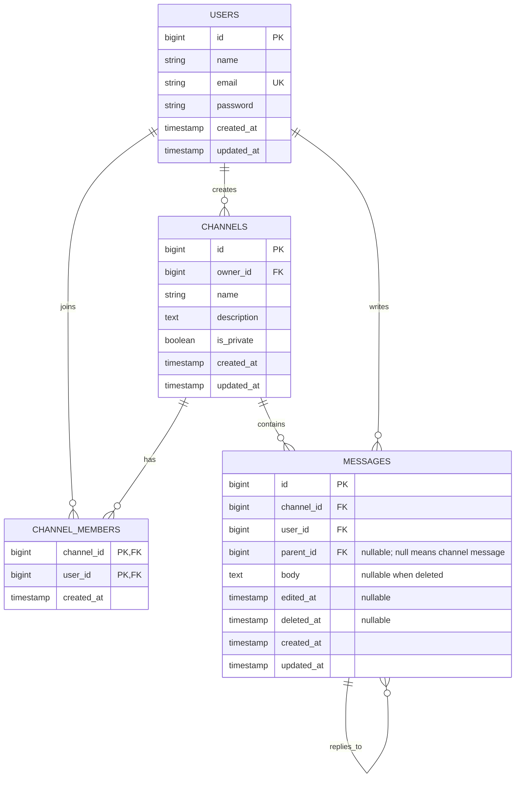

# データ設計

## ER図

## テーブル定義

| テーブル | 主な制約・意味 |
|:--|:--|
| users | email は一意。name は30文字以内。パスワードはハッシュ化して保存。 |
| channels | owner_id は作成者。is_private で公開範囲を固定。name は同じ公開範囲内で一意（公開・非公開それぞれで重複不可）。description は200文字以内。 |
| channel_members | (channel_id, user_id) を複合主キーとする。チャンネル作成時、作成者を必ず登録する。 |
| messages | parent_id が null の行がチャンネル投稿、値ありは返信。返信の parent_id は必ず親投稿を指し、返信への返信は禁止。body は1,000文字以内。編集後 edited_at を設定。削除時 deleted_at を設定し、body は null にする。 |

チャンネル名の一意性は公開範囲ごとに適用し、名前比較はアプリケーションのDB照合順序に従う。メッセージと返信はチャンネル削除時に連鎖削除する。投稿の論理削除では投稿行と返信を保持する。

## CRUD表

| 対象 | 作成 | 読み取り | 更新 | 削除 |
|:--|:--|:--|:--|:--|
| users | 本人登録・初期シーダー | 本人認証、画面に必要なユーザー検索 | なし | なし |
| channels | ログインユーザー | 公開は全員、非公開はメンバー | 作成者 | 作成者（関連投稿も削除） |
| channel_members | 作成者（作成時はシステム） | 当該チャンネル作成者 | — | 作成者（自身を除く） |
| messages | 閲覧可能なチャンネルのログインユーザー | 同じ閲覧権限 | 投稿者 | 投稿者（論理削除） |
