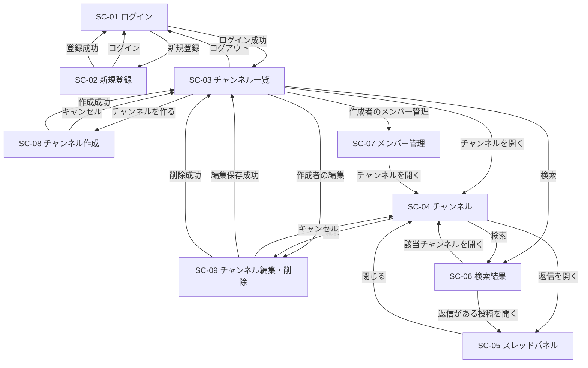

# 画面設計

画面と項目は `docs/spec.md`、`docs/design/features.md`、`docs/design/questions.md`、`mockup/` を根拠にする。Q-05 と Q-08 の未回答部分は `questions.md` に記録された自己判断（チャンネル名を入力して削除確認、本文の部分一致検索）を採用する。

## 画面一覧

| ID | 画面 | 主な利用者 | 主な操作 |
|:--|:--|:--|:--|
| SC-01 | ログイン | 未ログインの社員 | メールアドレス・パスワードでログイン、新規登録へ移動 |
| SC-02 | 新規登録 | 未ログインの社員 | アカウント登録、ログインへ移動 |
| SC-03 | チャンネル一覧 | ログイン社員 | 閲覧可能なチャンネルを開く、作成、作成者向け編集・メンバー管理 |
| SC-04 | チャンネル | 当該チャンネルを閲覧できるログイン社員 | メッセージ閲覧・投稿、自分の投稿の編集・削除、スレッドを開く |
| SC-05 | スレッドパネル | SC-04 と同じ閲覧権限 | 親メッセージと返信の閲覧、返信 |
| SC-06 | 検索結果 | ログイン社員 | 本文を検索し、結果のチャンネルまたはスレッドを開く |
| SC-07 | メンバー管理 | プライベートチャンネルの作成者 | メンバーの検索・追加・削除 |
| SC-08 | チャンネル作成 | ログイン社員 | 名前・説明・公開範囲を指定して作成 |
| SC-09 | チャンネル編集・削除 | チャンネル作成者 | 名前・説明の編集、確認後のチャンネル削除 |

## 画面遷移図

矢印はモックアップのリンク、機能要件、確認事項への回答、または機能要件から定まる移動を表す。

ログインとチャンネルの作成・編集保存・削除の成功後は、確認回答に従ってチャンネル一覧へ移動する。登録成功後は、登録後にログインするという仕様に沿ってログイン画面へ移動する。その他はモックアップのリンクと機能要件に示された導線を記載した。

## 画面項目定義

同じアプリ共通部（上部バー、サイドバー、ログイン利用者名、ログアウト、検索導線）は、ログイン後画面で共通とする。以下は画面ごとに固有の項目と操作を記す。

| 画面 | 項目・操作 |
|:--|:--|
| SC-02 新規登録 | 表示名（30文字以内）、メールアドレス、パスワード（8文字以上）、パスワード確認、登録ボタン。表示名の用途とパスワードの下限を補足表示する。 |
| SC-04 チャンネル | チャンネル名、公開範囲、説明、古いものから新しいものへのメッセージ一覧、投稿欄。メッセージには投稿者・日時・本文を表示し、編集済み表示と削除済み表示を付ける。返信件数からスレッドを開ける。自分の投稿に編集・削除操作を出し、作成者にはチャンネル編集・削除導線を出す。 |
| SC-05 スレッドパネル | 対象チャンネル、親メッセージ、返信件数、返信一覧、返信入力欄。返信は親に対する1段のみ。削除済み親は削除済み表示を残し、返信は表示・追加できる。 |
| SC-06 検索結果 | キーワード入力欄、検索ボタン、結果件数、メッセージ本文、チャンネル名、投稿者、日時。0件時は「別のキーワードで試すか、キーワードを短くしてください。」を表示。ログイン利用者が閲覧できるチャンネルに限定し、メッセージ本文を部分一致で検索する（Q-08 の記録済み判断）。 |
| SC-08 チャンネル作成 | チャンネル名（50文字以内）、説明（200文字以内）、公開／プライベート選択肢、作成する・キャンセル。公開範囲の説明を選択肢ごとに表示する。 |
| SC-09 チャンネル編集・削除 | チャンネル名（50文字以内）、説明（200文字以内）、公開範囲変更不可の説明、保存する・キャンセル。削除領域に対象名、投稿・返信の件数、復元不可の説明、確認用チャンネル名入力、やめる・削除するを表示する。 |

### 項目定義の範囲

固有の入力、状態表示、操作がまとまって現れる SC-02、SC-04〜SC-06、SC-08〜SC-09 の6画面を選んだ。SC-01 は SC-02 と共通する認証入力とエラー表示のため、SC-03 は一覧と各行の移動操作が中心のため、SC-07 は一覧と権限による操作差が中心のため、項目表では省いた。ログインの入力は下の入力チェック表に含め、一覧の権限差は機能一覧・権限設計と画面一覧で確認できる。共通ヘッダーとサイドバーもログイン後画面で反復するため、共通部として一度だけ記載した。

## 入力チェックとエラーメッセージ

文字数上限は `docs/spec.md` に従う。必須入力は、入力値の前後の空白と改行を取り除いた結果が空なら未入力として扱う。エラー表示の見せ方は `mockup/design-guide.md` に従い、文言がモックアップにある場合はそのまま用いる。モックアップに文言がない項目は Q-16 の回答に基づき、同じ短い「〜してください」形式で記す。

| 画面・入力 | チェック | エラーメッセージ |
|:--|:--|:--|
| SC-01 メールアドレス | 必須、メール形式 | メールアドレスを入力してください／メールアドレスの形式が正しくありません |
| SC-01 パスワード | 必須。ログイン時にメールアドレスと組み合わせて認証 | パスワードを入力してください／（認証失敗時）メールアドレスまたはパスワードが正しくありません |
| SC-02 表示名 | 必須、30文字以内 | 表示名を入力してください／表示名は30文字以内で入力してください |
| SC-02 メールアドレス | 必須、メール形式、登録済みアドレスと重複不可 | メールアドレスを入力してください／メールアドレスの形式が正しくありません／このメールアドレスはすでに登録されています |
| SC-02 パスワード | 必須、8文字以上 | パスワードを入力してください／8文字以上で入力してください |
| SC-02 パスワード（確認用） | 必須、パスワードと一致 | パスワードを入力してください／パスワードが一致しません |
| SC-04・SC-05 メッセージ／返信（新規投稿） | 必須、1,000文字以内 | メッセージを入力してください／1,000文字以内で入力してください |
| SC-04・SC-05 メッセージ／返信（その場編集） | 必須、1,000文字以内 | メッセージを入力してください／1,000文字以内で入力してください |
| SC-06 検索キーワード | 空欄不可 | キーワードを入力してください |
| SC-08・SC-09 チャンネル名 | 必須、50文字以内。同じ公開範囲に同名チャンネルがないこと | チャンネル名を入力してください／チャンネル名は50文字以内で入力してください／同じ公開範囲に同じ名前のチャンネルがあります |
| SC-08・SC-09 説明 | 200文字以内 | 200文字以内で入力してください |
| SC-09 削除確認用チャンネル名 | 入力値が対象チャンネル名と一致すること | チャンネル名が一致しません |

入力文字数はモックアップにある登録名・チャンネル名・説明・メッセージのカウンター表示に合わせて示す。メールアドレスの形式・重複、パスワード一致、同名チャンネル、検索語、削除確認のエラー文言はモックアップに例がないため、Q-16 の承認範囲で文言を整えた。作成者を外せるかどうかは入力値の検証項目ではないため、この表には含めない。
