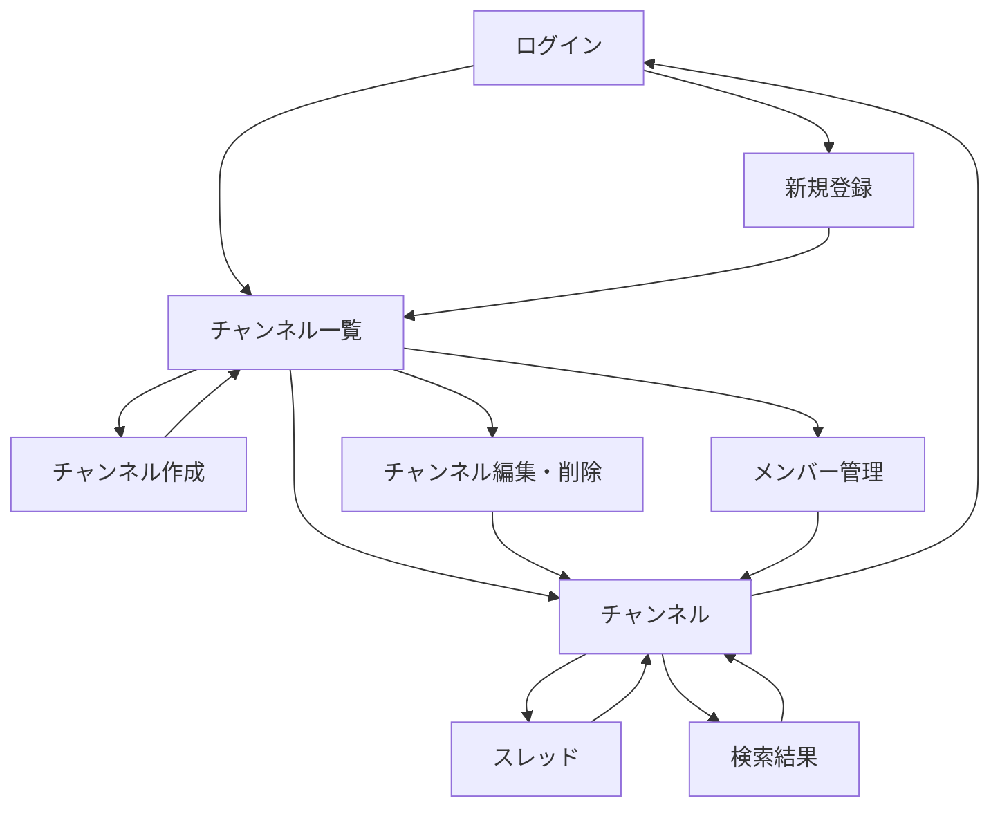

# 画面設計

## 画面一覧

| ID | 画面 | 主な利用者 | 主な操作 |
|:--|:--|:--|:--|
| S-01 | ログイン | 未ログイン | ログイン、新規登録へ |
| S-02 | 新規登録 | 未ログイン | アカウント作成 |
| S-03 | チャンネル一覧 | ログイン | 一覧・作成・閲覧・編集・メンバー管理 |
| S-04 | チャンネル | ログイン（閲覧権限あり） | メッセージ投稿・編集・削除・スレッド表示 |
| S-05 | スレッド | ログイン（閲覧権限あり） | 返信の閲覧・投稿 |
| S-06 | 検索結果 | ログイン | 本文検索、該当位置を開く |
| S-07 | チャンネル作成 | ログイン | チャンネル作成 |
| S-08 | チャンネル編集・削除 | 作成者 | 名前・説明の編集、削除 |
| S-09 | メンバー管理 | プライベートチャンネル作成者 | メンバー追加・削除 |

## 画面遷移

## 主要画面項目

| 画面 | 項目・振る舞い |
|:--|:--|
| ログイン | メールアドレス、パスワード、ログイン、登録へのリンク。認証失敗は「メールアドレスまたはパスワードが正しくありません」。 |
| 新規登録 | 表示名、メールアドレス、パスワード、確認用パスワード、登録。 |
| チャンネル一覧 | 閲覧可能なチャンネルのみ表示。名前、公開範囲、説明、作成者。作成者に限り編集導線、プライベート作成者に限りメンバー管理導線。 |
| チャンネル | 名前、公開範囲、説明、古い順のメッセージ。各投稿は投稿者・日時・本文・編集済み表示・返信数を持つ。削除済み投稿は本文を置換表示。投稿欄を末尾に置く。 |
| スレッド | 親投稿とその1段返信を時系列表示し、返信入力欄を置く。親投稿が削除済みでも返信を表示・追加できる。 |
| 検索結果 | 検索語、結果本文、チャンネル名、投稿者、日時。結果は閲覧可能なチャンネル内に限定。0件時は次の検索を促す。 |
| チャンネル作成 | 名前、説明、公開範囲のラジオ選択、作成・キャンセル。作成者をプライベートメンバーとして登録する。 |
| チャンネル編集・削除 | 名前、説明を編集。公開範囲は変更不可。削除領域に対象・影響件数・取り消し不可の説明を表示する。確認方法は Q-05 回答待ち。 |
| メンバー管理 | メンバー検索・追加、氏名・メール・作成者表示・削除操作。作成者の削除操作は無効。 |

## 入力チェックとメッセージ

| 入力 | チェック | 表示 |
|:--|:--|:--|
| 表示名 | 必須、30文字以内 | 表示名を入力してください／表示名は30文字以内で入力してください |
| メールアドレス | 必須、形式、重複不可 | 有効なメールアドレスを入力してください／このメールアドレスはすでに登録されています |
| パスワード | 必須、登録時8文字以上 | パスワードは8文字以上で入力してください |
| パスワード確認 | 必須、一致 | パスワードが一致しません |
| チャンネル名 | 必須、50文字以内、同一公開範囲で重複不可 | チャンネル名を入力してください／チャンネル名は50文字以内で入力してください／この公開範囲に同じ名前のチャンネルがあります |
| 説明 | 200文字以内 | 説明は200文字以内で入力してください |
| メッセージ・返信 | 必須、1,000文字以内 | メッセージを入力してください／メッセージは1,000文字以内で入力してください |
| 検索語 | 必須 | キーワードを入力してください |

空欄・上限超過はクライアント側で案内し、サーバーでも検証する。エラー表示は `mockup/design-guide.md` に従う。検索の部分一致／完全一致は Q-08 回答待ち。
